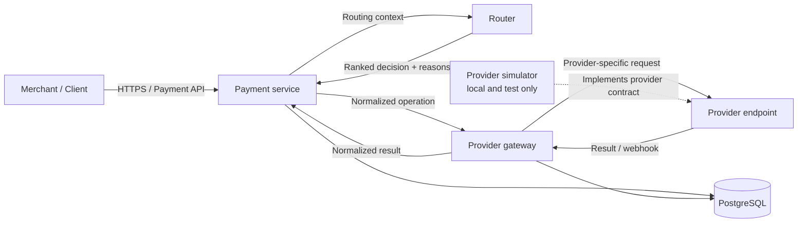
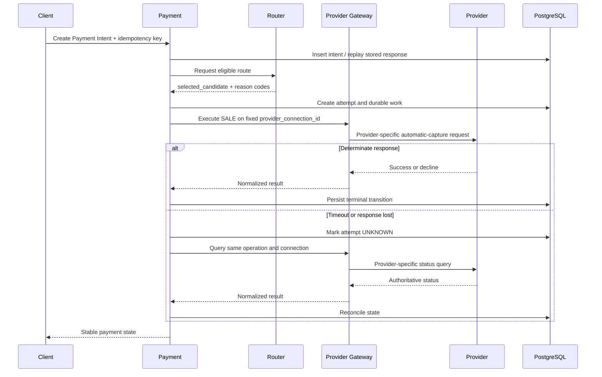

# 系统架构

## 目标

第一阶段交付一个最小但语义完整的支付闭环：接收 Payment Intent、持久化幂等结果、选择 provider、创建 Payment Attempt、处理 provider 结果，并让超时或响应丢失的请求通过查询与对账最终收敛。

仓库使用一个 Go module 和多个独立二进制。代码组织方式不削弱运行时边界；payment、router、provider-gateway 和 simulator 分别构建、部署、扩缩和发布。单 module 能在边界尚未稳定时避免跨 module 版本与本地 `replace` 的额外成本。

## 运行时拓扑

生产环境的 `Provider endpoint` 必须是真实、经过审核的 provider adapter。Compose 中的 simulator 只是该外部契约的测试替身，不能进入 live 环境。

## 服务边界

### Payment

Payment 服务提供公共支付 API，并拥有支付生命周期及自己的 PostgreSQL 数据。入口层负责请求大小和超时约束、商户身份上下文及请求关联 ID；领域层负责：

- Payment Intent 与 Payment Attempt 状态机；
- `(merchant_id, idempotency_key)` 的持久化唯一性；
- 在同一数据库事务内写入业务状态和 outbox；
- 为每个 Provider Operation 生成一次稳定 ID，并在同一 Provider connection 内复用为幂等键；
- 接收并去重 gateway 归一化后的 provider outcome；
- 将未知结果送入查询和 reconciliation，而不是立即换路重试。

第一阶段的 durable worker 可以和 payment HTTP 进程位于同一部署单元。若吞吐或故障隔离需要独立扩缩，可将 worker 拆成新二进制，但数据库所有权仍属于 payment 边界。

### Router

Router 接收已经规范化的 routing context，先执行币种、地区、支付方式和能力等硬约束，再根据明确策略给出排序后的候选 provider、选择结果和 reason codes。它不发起扣款、不写 payment 数据库，也不能把统计得分覆盖在资格约束之上。

Router 候选项不是 PSP 品牌字符串，而是稳定 `candidate_id`：它同时标识 Provider、Merchant Account、Connector 与 Region，并返回 `connection_revision` 和 `provider_namespace_id`。Payment 将 ID 固定为 `provider_connection_id`，连同 revision、namespace 与 provider 持久化到 Attempt 和 Operation；Provider Gateway 只能执行这条精确连接。Provider 名称仍用于选择 adapter kind，但不能替代连接身份。Gateway 的不可变 revision registry 防止相同 ID/revision 被重新绑定到不同执行配置，详见 [ADR 0002](adr/0002-immutable-provider-connections.md)。

### Provider Gateway

Provider-gateway 是内部 provider 集成边界。它将统一支付操作映射为 provider-specific HTTP 请求、认证和错误类型，并把响应归一化后交还 payment。它不选择 provider、不拥有 Payment Intent，也不能把网络超时解释成确定失败。它拥有独立的 operation、webhook inbox 与 outbox schema，用于保证外部副作用调用和回调的幂等性；payment 不直接读取这些表。

### Simulator

Simulator 提供确定、可脚本化的 provider 行为，包括成功、业务拒绝、超时和响应丢失。它必须在启动时拒绝非 `local`、`development` 或 `test` 环境，并永久拒绝真实凭证；webhook 重放与乱序由测试直接注入 Gateway 验证。

## 数据与一致性

PostgreSQL 是第一阶段唯一的权威数据存储。Compose 为降低本地成本而复用一个 PostgreSQL 实例和开发账号，但表所有权仍按服务隔离：

- payment 拥有默认 namespace 中的 `payment_intents`、`payment_attempts`、API `idempotency_records` 和自己的 `outbox_events`；
- provider-gateway schema 拥有 provider operations、不可变 connection-revision registry、以 `(provider_namespace_id, event_id)` 去重的 webhook inbox，以及向 payment 传递归一化结果的 outbox；
- 两个服务不能通过 SQL 跨边界读取对方的表，边界间数据只能通过服务契约或已定义的事件传递。E2E 验证程序可以只读两侧数据来断言“只有一条资金路径”，但运行中的服务没有这个权限约定。

Compose 的共享数据库账号只是本地便利，不能照搬到 production。真实部署必须为 payment 与 provider-gateway 配置独立 role 和最小权限 grant，最好使用独立 database；Payment Method 字段只允许保存受控 vault reference，并结合 KMS、访问审计与保留期策略保护它。

Provider-gateway 使用自己的 PostgreSQL outbox 向 payment 至少一次投递 outcome，因此接收方必须幂等。Payment reconciler 直接扫描自己拥有的持久化 operation 状态；状态迁移同时写入 payment outbox，为后续事件消费者保留事务边界，但第一阶段尚未连接 payment outbox publisher。Provider-gateway 当前只运行一个 active outbox dispatcher；扩展为多个 dispatcher 前，必须增加带 lease 的 claim 或 `FOR UPDATE SKIP LOCKED`。可以使用 `LISTEN/NOTIFY` 减少轮询延迟，但通知只用于唤醒，outbox 表才是真相源。

Payment inbox 会把无法关联、重复 ID 但 payload 不同以及违反领域不变量的 outcome 持久化到 quarantine。Provider reference 与 event ID 的碰撞域是稳定 namespace，recovery alias 与 canonical connection 不能借不同 ID 绕过检测；namespace 不是 webhook secret 的信任域，跨路径关联必须有显式 alias 授权。若同一 namespace 的 Provider reference 被两笔 Attempt 声称，两个 Payment Intent 都会在同一事务中标记为 `review_required`；已确认的成功事实不会回退，未终结的 operation 则进入不可自动领取的手工复核状态。授权证据与确定失败互相矛盾时采用相同处理，直到明确的 reversal、void 或人工处置证明资金状态。

第一阶段不使用 Redis、Redis Pub/Sub、Kafka 或其他 broker。只有当跨边界消费者、持续高吞吐、长时间 replay 等需求被实际测量出来后，才引入消息基础设施，并继续通过 transactional outbox 避免数据库与 broker 双写。

## 核心请求路径

网络超时只能说明客户端没有收到答案，不能证明 provider 没有完成请求。只有已证明原 attempt 未生效，系统才能评估是否创建下一次 attempt。

## 运行与可观测性

每个 HTTP 服务提供：

- `/livez`：只证明进程可以继续服务，不探测下游依赖；
- `/readyz`：只探测该服务必需的依赖，且不调用外部 provider；
- `/metrics`：当前至少输出进程存活 gauge，并为后续有限基数的技术和业务指标保留稳定入口。

当前服务使用结构化 JSON 日志，但第一阶段还没有完整的请求关联中间件。进入真实试运行前必须生成并传播 `request_id`，并在相关状态迁移日志中携带 `payment_intent_id`、`attempt_id` 和 provider 等非敏感关联字段。任何日志、trace、metric 或事件都不得包含 PAN、CVV、访问令牌或 provider 密钥。

进入真实试运行前仍需补齐请求延迟和错误率、状态迁移计数、provider 结果、outbox 深度与最老消息年龄、UNKNOWN 数量和 reconciliation 结果。支付 ID、商户 ID 和用户标识不能成为 metric label。

OpenTelemetry exporter 应为配置可选项；没有 endpoint 时使用 no-op。第一阶段默认开发栈不捆绑 Grafana、Tempo、Jaeger 等组件，避免让本地启动依赖与支付语义无关的服务。

## 演进边界

只有在以下条件出现时才扩充基础设施：

- 单个部署单元需要独立 Go 版本或被仓库外消费时，拆 module 并添加 `go.work`；
- durable worker 与 HTTP 流量在扩缩或故障域上显著冲突时，拆分 payment worker；
- 有多个独立消费者、明确 replay 需求或 PostgreSQL queue 达到测量瓶颈时，引入 broker；
- 限流、短期缓存有清晰数据后再引入 Redis，且 Redis 永不成为支付状态的唯一保存位置。
